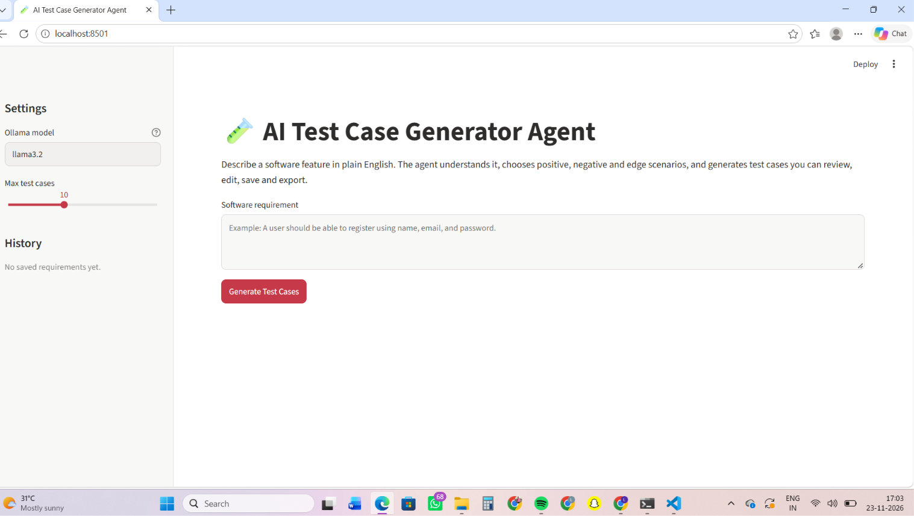
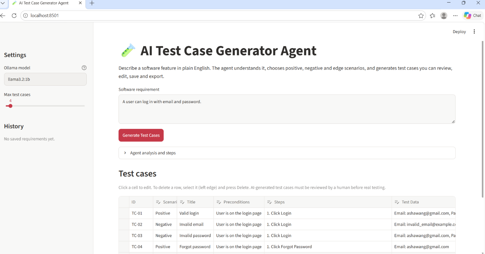
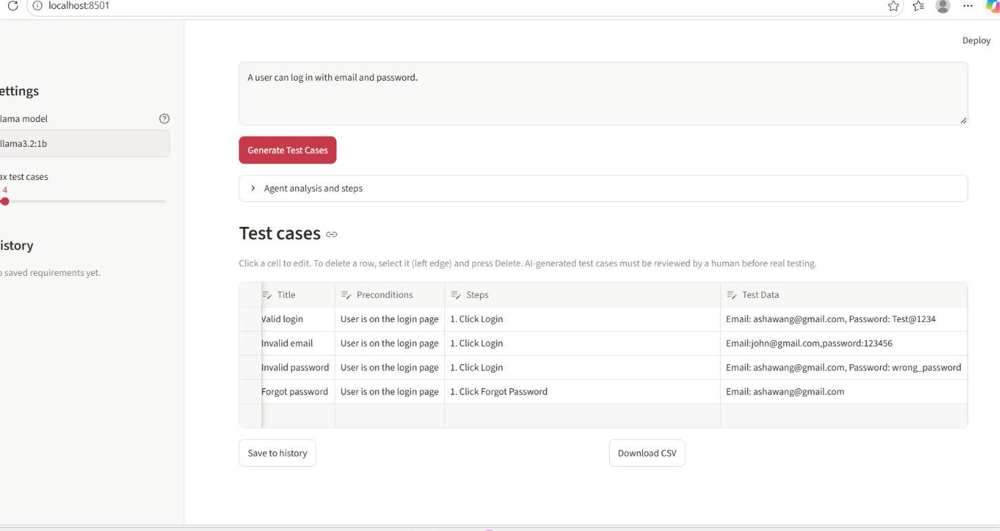
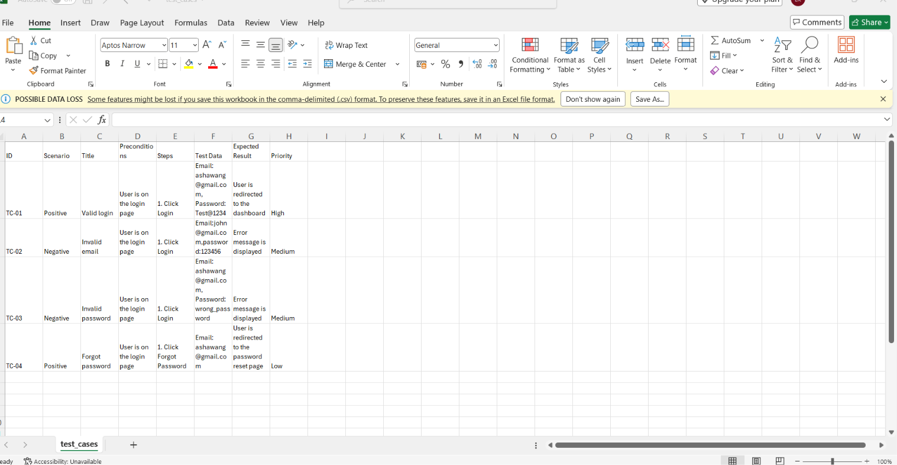

# AI Test Case Generator Agent

A Streamlit web app that turns a plain-English software requirement into structured **positive, negative and edge-case test cases**. It uses a **local LLM (Ollama)** connected through **LangChain**. You can review, edit and delete the generated cases, save them in **SQLite**, and export them as a **CSV** file.

> AI-generated test cases must be reviewed by a human before they are used for real testing.

## Screenshots









## Features

- Enter a feature requirement in simple English
- The agent identifies the feature, its conditions and assumptions
- Selects suitable positive, negative and edge-case scenario types
- Generates test cases with title, preconditions, steps, test data, expected result and priority (High, Medium or Low)
- Edit cells and delete rows in the results table
- Save requirements and test cases to SQLite and reload them from the History sidebar (history remains after restarting the app)
- Download the final test cases as a CSV file
- Handles empty input, unclear requirements, invalid model output and local model errors

## Tech Stack

| Technology | Purpose |
|---|---|
| Python | Application logic and test case processing |
| Streamlit | User interface and test case dashboard |
| Ollama + local LLM | Understands requirements and generates test cases locally |
| LangChain | Connects the local model and organises the agent chain |
| SQLite | Stores requirements and generated test cases |
| Pandas | Displays and exports test cases as CSV |
| Git and GitHub | Version control and submission |

## How It Works (Agent Workflow)

1. **check_input** (Python): rejects empty or very short input
2. **analyze + generate** (LLM, one call): identifies the feature, conditions, assumptions and scenario categories, and writes the test cases as JSON
3. **select_scenarios** (Python): keeps only the supported categories (positive, negative, edge)
4. **validate** (Python): checks required fields, limits priority to High, Medium or Low, removes duplicates and assigns IDs (TC-01, TC-02, ...)
5. The user reviews, edits or deletes cases, then saves them or downloads the CSV

If the model returns invalid JSON, the agent retries up to two more times with a correction hint. If Ollama is not running, the app shows a clear error message and does not crash.

## Project Structure

```
ai-test-case-generator-agent/
├── app.py                  # Streamlit UI, history sidebar, editable table, CSV download
├── agent.py                # Agent actions, LangChain chain (prompt -> Ollama -> parser), retries
├── test_case_generator.py  # Validation and normalisation of model JSON, ID assignment
├── prompts.py              # System prompts and input builders
├── database.py             # SQLite storage (requirements and test_cases tables)
├── export_utils.py         # Table clean-up, input checks, CSV bytes
├── requirements.txt
├── screenshots/            # Images used in this README
└── .gitignore
```

## Setup and Run

1. **Install Ollama** from https://ollama.com and make sure it is running.
2. **Download a model:**
   ```
   ollama pull llama3.2:1b
   ```
   `llama3.2:1b` is fast on a CPU-only laptop. `llama3.2` or `qwen2.5:3b` give better quality but are slower.
3. **Create a virtual environment and install packages:**
   ```
   python -m venv venv
   venv\Scripts\activate
   pip install -r requirements.txt
   ```
   On Mac or Linux, use `source venv/bin/activate`.
4. **Start the app:**
   ```
   streamlit run app.py
   ```
5. Open http://localhost:8501, type the same model name in the **Ollama model** box in the sidebar, enter a requirement and click **Generate Test Cases**.

Example requirement:
> A user should be able to register using name, email, and password.

## Database Structure

**requirements**

| Column | Description |
|---|---|
| id | Primary key |
| requirement | The text entered by the user |
| feature | Feature name identified by the agent |
| assumptions | Assumptions listed by the agent |
| created_at | Date and time saved |

**test_cases**

| Column | Description |
|---|---|
| id | Primary key |
| requirement_id | Foreign key to requirements (deleted together) |
| tc_id | Test case ID, e.g. TC-01 |
| scenario | Positive, Negative or Edge |
| title, preconditions, steps, test_data, expected_result | Test case details |
| priority | High, Medium or Low |

## Testing Checklist

| Test | Expected behaviour |
|---|---|
| Empty requirement | Asks the user to enter a requirement |
| Valid registration requirement | Generates relevant registration test cases |
| Login requirement | Generates test cases relevant to login |
| Very short or unclear requirement | Asks for clarification, or continues with clearly stated assumptions |
| Ollama stopped | Shows a helpful error without crashing |
| Invalid model output | Retries safely, then shows an error |
| Edit and delete test cases | Updates or removes the selected case |
| Save and reload history | Saved cases remain after restarting the app |
| CSV export | Downloaded CSV contains the displayed test cases |

## Limitations

- Small local models (such as the 1B model) can write very short steps, repeat ideas or add features that were not in the requirement. A human must review every case.
- Generation is slow on a CPU-only computer, especially for larger models and many test cases.
- The model's output is validated for structure, but not for whether the test cases are logically correct.
- The app has no user accounts, so history is shared by everyone who uses the same database file.

## Author

Likitha Kalal - [github.com/likki-hi](https://github.com/likki-hi)